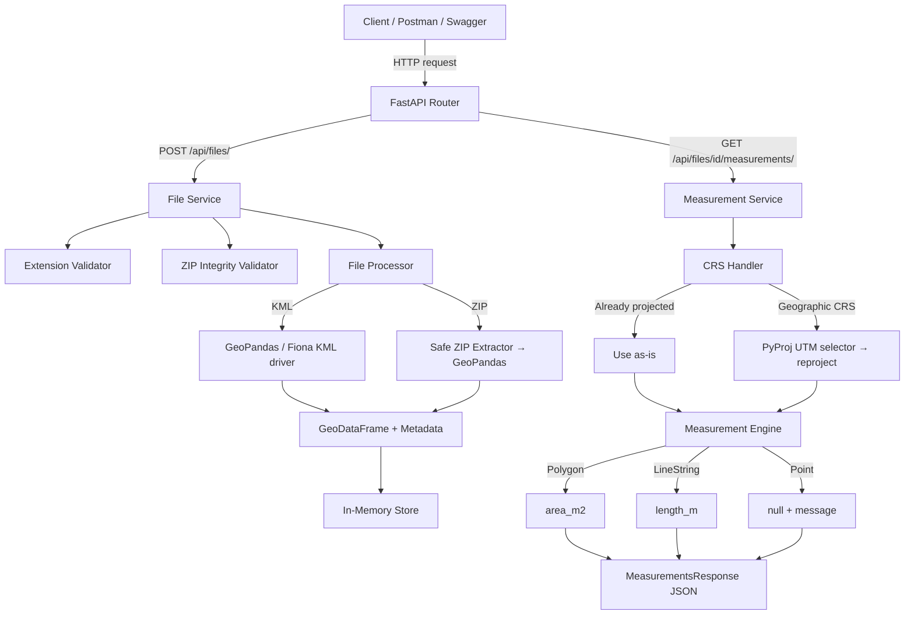

# GeoMeasure API

A REST API for uploading geospatial files, extracting geographic features, and calculating metric measurements — built with FastAPI and GeoPandas.

---

## Table of Contents

1. [Overview](#1-overview)
2. [Problem Statement](#2-problem-statement)
3. [Features](#3-features)
4. [Technology Stack](#4-technology-stack)
5. [Architecture](#5-architecture)
6. [Project Structure](#6-project-structure)
7. [Installation Without Docker](#7-installation-without-docker)
8. [Docker Setup](#8-docker-setup)
9. [API Endpoints](#9-api-endpoints)
10. [File Processing Flow](#10-file-processing-flow)
11. [CRS Handling](#11-crs-handling)
12. [Measurement Logic](#12-measurement-logic)
13. [Error Handling](#13-error-handling)
14. [Testing](#14-testing)
15. [Docker Verification](#15-docker-verification)
16. [Design Decisions](#16-design-decisions)
17. [Security Considerations](#17-security-considerations)
18. [Future Improvements](#18-future-improvements)
19. [What I Learned](#19-what-i-learned)
20. [Example End-to-End Usage](#20-example-end-to-end-usage)

---

## 1. Overview

GeoMeasure API accepts KML files and ZIP-packaged ESRI Shapefiles, parses their geographic features, and returns per-feature metric measurements — polygon area in square metres and LineString length in metres. It handles coordinate reference system (CRS) detection and automatic reprojection so that measurements are always in real-world metric units regardless of how the source data was projected.

---

## 2. Problem Statement

Geospatial files come in many formats and coordinate systems. Calculating meaningful measurements (area, length) directly from geographic coordinates (degrees of latitude/longitude) produces incorrect results because degrees are not a unit of distance. The core challenge this API solves is:

- Accept a KML or ZIP Shapefile upload from a client
- Parse and extract the geographic features it contains
- Identify the geometry type of each feature (Polygon, LineString, Point, etc.)
- Detect the source CRS and handle missing CRS safely
- Reproject geographic data into an appropriate metric CRS before measuring
- Return accurate area (m²) and length (m) values per feature via a JSON API

---

## 3. Features

- **KML upload and parsing** — reads KML files via Fiona with the KML/LIBKML driver
- **ZIP Shapefile upload and parsing** — safely extracts and reads ESRI Shapefiles from ZIP archives
- **Polygon area** — returns area in square metres (m²)
- **LineString length** — returns length in metres (m)
- **Point handling** — recognised as valid geometry; returns a structured null measurement with an informational message
- **MultiPolygon and MultiLineString** — area and length calculated as the sum of all parts
- **CRS-aware measurements** — source CRS is detected and used to guide reprojection
- **Dynamic UTM zone selection** — geographic CRS (e.g. EPSG:4326) is automatically reprojected to the best-fit UTM zone for the dataset's bounding box using PyProj
- **Missing CRS rejection** — files without a CRS are safely rejected at measurement time with a clear error message
- **ZIP Slip / path traversal protection** — all ZIP entries are validated before extraction
- **ZIP integrity validation** — corrupted or non-ZIP files are rejected before processing
- **File extension validation** — only `.kml` and `.zip` are accepted
- **Safe file naming** — uploaded files are stored as `{id}_{original_filename}` to prevent collisions
- **Structured error responses** — all errors return JSON with a `detail` field and an appropriate HTTP status code
- **REST API** — three endpoints covering upload, metadata retrieval, and measurements
- **Swagger UI** at `/docs` and ReDoc at `/redoc`
- **Automated test suite** — 63 tests, 0 failures
- **Docker support** — single-container deployment with all geospatial system libraries included

---

## 4. Technology Stack

| Component | Technology | Version |
|---|---|---|
| Language | Python | 3.11 |
| Web framework | FastAPI | 0.136.1 |
| Data validation | Pydantic + pydantic-settings | 2.13.4 / 2.14.1 |
| ASGI server | Uvicorn (with standard extras) | 0.47.0 |
| Geospatial data | GeoPandas | 1.2.0 |
| Geometry engine | Shapely | 2.1.2 |
| CRS / projection | PyProj | 3.7.2 |
| File I/O | Fiona | 1.10.1 |
| Testing | Pytest + HTTPX | 9.1.1 / 0.28.1 |
| Containerisation | Docker (python:3.11-slim + GDAL/GEOS/PROJ) | — |

---

## 5. Architecture

### Request flow



### Layer responsibilities

| Layer | Module | Responsibility |
|---|---|---|
| Routes | `app/api/routes/files.py` | HTTP interface — receives requests, calls services, returns responses |
| File Service | `app/services/file_service.py` | Orchestrates upload: validates, persists, processes, stores |
| File Processor | `app/services/file_processor.py` | Reads KML/Shapefile into a GeoDataFrame; no HTTP knowledge |
| CRS Handler | `app/services/crs_handler.py` | Detects CRS type; reprojects geographic data to best-fit UTM |
| Measurement Engine | `app/services/measurement.py` | Computes per-feature area/length from a projected GeoDataFrame |
| Measurement Service | `app/services/measurement_service.py` | Orchestrates measurement: retrieves record, delegates to CRS handler and engine |
| Storage | `app/storage/store.py` | In-memory dict store; holds FileRecord objects including the GeoDataFrame |
| Validators | `app/utils/validators.py` | Extension check and ZIP integrity check |
| Schemas | `app/models/schemas.py` | Pydantic request/response models |
| Config | `app/core/config.py` | App settings via pydantic-settings; reads optional `.env` |

---

## 6. Project Structure

```
geo-measure-api/
├── app/
│   ├── api/
│   │   └── routes/
│   │       └── files.py          # Route handlers
│   ├── core/
│   │   └── config.py             # App settings
│   ├── models/
│   │   └── schemas.py            # Pydantic response models
│   ├── services/
│   │   ├── crs_handler.py        # CRS detection and UTM reprojection
│   │   ├── file_processor.py     # KML and Shapefile parsing
│   │   ├── file_service.py       # Upload orchestration
│   │   ├── measurement.py        # Per-feature area/length calculation
│   │   └── measurement_service.py# Measurement orchestration
│   ├── storage/
│   │   └── store.py              # In-memory file record store
│   ├── utils/
│   │   └── validators.py         # Extension and ZIP validators
│   └── main.py                   # FastAPI app entry point
├── tests/
│   ├── fixtures.py               # Programmatic geospatial test data builders
│   ├── test_crs.py               # CRS detection and UTM selection tests
│   ├── test_health.py            # Health endpoint test
│   ├── test_measurements.py      # Unit tests for measurement engine
│   ├── test_measurements_api.py  # Integration tests for measurements endpoint
│   ├── test_processing.py        # File processing and validation tests
│   └── test_upload.py            # Upload endpoint tests
├── uploads/                      # Runtime upload directory (git-ignored)
├── sample_data/                  # Intentional sample files (currently empty)
├── .dockerignore
├── .gitignore
├── Dockerfile
└── requirements.txt
```

---

## 7. Installation Without Docker

**Prerequisites:** Python 3.11+, and GDAL/GEOS/PROJ system libraries installed.

```bash
# Clone the repository
git clone https://github.com/varunib/geospatial-measurement-api.git
cd geospatial-measurement-api

# Create and activate a virtual environment
python -m venv .venv

# Windows
.venv\Scripts\activate

# macOS / Linux
source .venv/bin/activate

# Install dependencies
pip install -r requirements.txt

# Run the development server
uvicorn app.main:app --reload
```

The API will be available at `http://localhost:8000`.  
Swagger UI: `http://localhost:8000/docs`

> **Note:** On Windows/macOS without system GDAL libraries, the Docker setup below is the recommended approach as it bundles all required native libraries.

---

## 8. Docker Setup

Docker is the recommended way to run this project because it includes all required geospatial system libraries (GDAL, GEOS, PROJ) without any manual installation.

```bash
# Build the image
docker build -t geo-measure-api .

# Run the container
docker run --name geo-measure-api -p 8000:8000 geo-measure-api
```

The API will be available at `http://localhost:8000`.

To run in detached mode:

```bash
docker run -d --name geo-measure-api -p 8000:8000 geo-measure-api
```

To stop and remove the container:

```bash
docker stop geo-measure-api
docker rm geo-measure-api
```

---

## 9. API Endpoints

### Health check

```
GET /health
```

Returns the application name, version, and status. Useful for container health probes.

**Response — 200 OK**
```json
{
  "status": "ok",
  "app": "GeoMeasure API",
  "version": "1.0.0"
}
```

---

### Upload a geospatial file

```
POST /api/files/
```

Upload a `.kml` or `.zip` (ESRI Shapefile) file. The file is validated, stored, and processed immediately. Returns file metadata including feature count and source CRS.

**Request** — `multipart/form-data`

| Field | Type | Description |
|---|---|---|
| `file` | file | A `.kml` or `.zip` file |

**Response — 201 Created**
```json
{
  "id": 1,
  "filename": "sample.kml",
  "feature_count": 3,
  "crs": "EPSG:4326",
  "status": "processed"
}
```

| Field | Description |
|---|---|
| `id` | Integer ID assigned to this upload; used in subsequent requests |
| `filename` | Original filename as uploaded |
| `feature_count` | Number of geographic features parsed from the file |
| `crs` | Source CRS as an EPSG string, or `null` if the file has no CRS |
| `status` | `"processed"` on success, `"failed"` if processing encountered an error |

**Error responses**

| Status | Condition |
|---|---|
| 400 | Unsupported file extension |
| 400 | Empty file |
| 400 | Corrupted or invalid ZIP archive |
| 400 | ZIP contains no `.shp` file |
| 400 | ZIP is missing `.shx` or `.dbf` sidecar files |
| 400 | KML file cannot be parsed or contains no features |
| 400 | ZIP entry contains a path traversal (Zip Slip) |
| 500 | Unexpected processing error |

---

### Get file information

```
GET /api/files/{id}/
```

Retrieve metadata for a previously uploaded file by its integer ID.

**Path parameter**

| Parameter | Type | Description |
|---|---|---|
| `id` | integer | File ID returned by the upload endpoint |

**Response — 200 OK**
```json
{
  "id": 1,
  "filename": "sample.kml",
  "feature_count": 3,
  "crs": "EPSG:4326",
  "status": "processed"
}
```

**Error responses**

| Status | Condition |
|---|---|
| 404 | No file with the given ID exists |

---

### Get measurements

```
GET /api/files/{id}/measurements/
```

Calculate and return per-feature metric measurements for a processed file.

- **Polygon** → `area_m2` in square metres
- **LineString** → `length_m` in metres
- **Point / MultiPoint** → `null` measurements with an informational message
- **MultiPolygon** → `area_m2` (sum of all parts)
- **MultiLineString** → `length_m` (sum of all parts)

Geographic CRS (e.g. EPSG:4326) is automatically reprojected to the best-fit UTM zone before measurement. The `projected_crs` field shows which CRS was used for calculation.

**Path parameter**

| Parameter | Type | Description |
|---|---|---|
| `id` | integer | File ID returned by the upload endpoint |

**Response — 200 OK**
```json
{
  "file_id": 1,
  "filename": "sample.kml",
  "source_crs": "EPSG:4326",
  "projected_crs": "EPSG:32644",
  "measurements": [
    {
      "feature_id": 0,
      "geometry_type": "Polygon",
      "area_m2": 123456.78,
      "length_m": null,
      "message": null
    },
    {
      "feature_id": 1,
      "geometry_type": "LineString",
      "area_m2": null,
      "length_m": 987.65,
      "message": null
    },
    {
      "feature_id": 2,
      "geometry_type": "Point",
      "area_m2": null,
      "length_m": null,
      "message": "No measurement applicable for Point."
    }
  ]
}
```

| Field | Description |
|---|---|
| `file_id` | ID of the file |
| `filename` | Original filename |
| `source_crs` | CRS stored on the file record (may be `null` for Shapefiles without `.prj`) |
| `projected_crs` | CRS actually used for measurement — always a metric projected CRS |
| `measurements` | Array of per-feature results |

**Error responses**

| Status | Condition |
|---|---|
| 404 | No file with the given ID exists |
| 422 | File processing previously failed |
| 422 | File has not been successfully processed |
| 422 | File has no CRS — metric measurement is not possible |

---

## 10. File Processing Flow

```
Upload request
    │
    ├─ Extension validation (.kml or .zip only)
    ├─ Empty file check
    ├─ ZIP integrity check (ZIP files only)
    │
    ├─ File saved to uploads/ as {id}_{filename}
    │
    ├─ KML path ──► GeoPandas reads via Fiona KML/LIBKML driver
    │                   └─► GeoDataFrame + feature count + CRS
    │
    └─ ZIP path ──► Safe ZIP extraction to temp directory
                        ├─ Path traversal check (Zip Slip protection)
                        ├─ Locate single .shp file
                        ├─ Validate .shx and .dbf are present
                        └─► GeoPandas reads Shapefile
                                └─► GeoDataFrame + feature count + CRS

Result stored in InMemoryStore as a FileRecord (status: "processed")
```

---

## 11. CRS Handling

### Why CRS matters for measurements

Geographic coordinate systems like EPSG:4326 express positions as degrees of latitude and longitude. Calling `.area` or `.length` on geometries in this CRS returns values in degrees squared or degrees — not square metres or metres. These values are meaningless for real-world measurement.

### The strategy implemented

The CRS handler (`app/services/crs_handler.py`) applies the following decision tree before any measurement is taken:

1. **No CRS** → raise `MissingCRSError`. The API returns HTTP 422 with a clear message. The CRS is never guessed.

2. **Already projected** (linear units = metres or feet) → use the GeoDataFrame as-is. The data provider's chosen projection is trusted.

3. **Geographic CRS** (angular units = degrees, e.g. EPSG:4326) → automatically select the best-fit UTM zone using PyProj's `query_utm_crs_info()`, which queries the PROJ authority database for the UTM CRS whose area-of-use best covers the dataset's bounding box. The GeoDataFrame is then reprojected to that UTM CRS before measurement.

### Why UTM?

UTM (Universal Transverse Mercator) zones are 6° wide and preserve area and length well within each zone. PyProj's `query_utm_crs_info()` selects the zone that best overlaps the dataset's extent, handling both hemispheres correctly without manual zone arithmetic.

### Fallback

In the extremely rare case where no UTM zone is found (e.g. data at the poles or invalid bounds), the handler falls back to EPSG:3857 (Web Mercator) rather than crashing.

---

## 12. Measurement Logic

All measurements are performed on a GeoDataFrame that has already been reprojected to a metric CRS by the CRS handler. The measurement engine (`app/services/measurement.py`) never reprojects data itself.

| Geometry type | Measurement | Field |
|---|---|---|
| `Polygon` | Area in m² via Shapely `.area` | `area_m2` |
| `MultiPolygon` | Combined area of all parts in m² | `area_m2` |
| `LineString` | Length in metres via Shapely `.length` | `length_m` |
| `MultiLineString` | Combined length of all parts in metres | `length_m` |
| `Point` / `MultiPoint` | No measurement | `null` + message |
| `null` geometry | No measurement | `null` + message |
| Empty geometry | No measurement | `null` + message |
| Other (e.g. `GeometryCollection`) | No measurement | `null` + message |

Invalid geometries (self-intersecting etc.) are not rejected — Shapely still returns a value and the response includes a note that the result may be approximate.

---

## 13. Error Handling

All error responses follow FastAPI's standard format:

```json
{
  "detail": "Human-readable error message."
}
```

| HTTP Status | When it occurs |
|---|---|
| `400 Bad Request` | Invalid file extension, empty file, corrupted ZIP, missing Shapefile components, unparseable KML, Zip Slip attempt |
| `404 Not Found` | File ID does not exist in the store |
| `422 Unprocessable Entity` | File processing previously failed; file has no CRS; file not yet processed |
| `500 Internal Server Error` | Unexpected exception during processing |

---

## 14. Testing

The test suite uses `pytest` with `httpx`-backed `TestClient` for integration tests. All test fixtures are programmatic — they build real geospatial data in memory using GeoPandas and Shapely, so no external files are required.

**Current result: 63 passed, 0 failed, 0 warnings**

```
pytest -q
...............................................................
63 passed in 7.48s
```

### Test files

| File | Coverage |
|---|---|
| `tests/test_health.py` | Health endpoint — status, app name, version |
| `tests/test_upload.py` | Upload endpoint — valid KML, valid ZIP, unsupported extension, empty file, corrupted ZIP |
| `tests/test_processing.py` | File processing — KML parsing, ZIP Shapefile parsing, feature count, CRS extraction, geometry types, missing CRS, invalid KML, missing Shapefile components, null geometry |
| `tests/test_crs.py` | CRS handler — geographic reprojection, projected passthrough, missing CRS error, UTM zone selection for multiple global locations |
| `tests/test_measurements.py` | Measurement engine — polygon area, LineString length, Point null result, projected CRS passthrough, missing CRS rejection, empty/null geometry, MultiPolygon, MultiLineString |
| `tests/test_measurements_api.py` | Measurements endpoint — full integration tests for all geometry types, CRS handling, error states, response structure |
| `tests/fixtures.py` | Shared builders — `make_kml_bytes()`, `make_shapefile_zip_bytes()`, `make_zip_without_shp()`, `make_corrupted_zip_bytes()`, etc. |

---

## 15. Docker Verification

The Docker setup was verified end-to-end:

| Check | Result |
|---|---|
| `docker build -t geo-measure-api .` | Build succeeded — all system libs and Python packages installed |
| `docker run --name geo-measure-api -p 8000:8000 geo-measure-api` | Container started; Uvicorn reported `Application startup complete` |
| `GET http://localhost:8000/health` | HTTP 200 — `{"status":"ok","app":"GeoMeasure API","version":"1.0.0"}` |
| `GET http://localhost:8000/docs` | HTTP 200 — Swagger UI accessible |
| `python -m pytest -v` | 63/63 tests passed |

The Dockerfile installs `libgdal-dev`, `libgeos-dev`, and `libproj-dev` system packages before installing Python dependencies, which is required for Fiona and PyProj to build correctly.

---

## 16. Design Decisions

**FastAPI over Flask or Django REST Framework**  
FastAPI provides automatic OpenAPI documentation, native async support, and Pydantic-based request/response validation with minimal boilerplate. The automatic Swagger UI at `/docs` is particularly useful for a geospatial API where clients need to inspect response shapes.

**GeoPandas + Shapely + PyProj + Fiona as the geospatial stack**  
This is the standard Python geospatial stack. GeoPandas provides the DataFrame abstraction over geometries; Shapely provides the geometry engine; PyProj handles CRS definitions and transformations; Fiona handles file I/O including the KML driver. Each library has a single, well-defined responsibility.

**CRS transformation is required, not optional**  
Measurements in degrees are not meaningful. The decision to always reproject geographic data before measuring — and to reject data with no CRS rather than guessing — ensures that every measurement returned by the API is physically meaningful.

**Dynamic UTM selection via PyProj**  
Rather than hardcoding a single projected CRS or requiring the client to specify one, the API automatically selects the best UTM zone for each dataset's geographic extent. This makes the API usable for data from any location worldwide without client-side configuration.

**In-memory storage**  
The store is a plain Python dict keyed by integer ID. This keeps the application self-contained with no external dependencies (no database, no Redis, no message queue). The store interface (`save`, `get`, `update`, `all`) is the only contract the rest of the application depends on, making it straightforward to replace with a database-backed implementation later.

**Separation of concerns across service layers**  
Each service module has one job: the file processor knows nothing about HTTP; the measurement engine knows nothing about CRS; the CRS handler knows nothing about storage. This makes each layer independently testable and replaceable.

**Docker for deployment**  
Geospatial Python libraries depend on native system libraries (GDAL, GEOS, PROJ) that are non-trivial to install consistently across operating systems. Docker eliminates this problem by bundling everything into a single reproducible image.

---

## 17. Security Considerations

The following protections are implemented:

- **Extension validation** — only `.kml` and `.zip` are accepted; all other extensions are rejected with HTTP 400 before any file content is read
- **ZIP integrity validation** — the ZIP file is validated with `zipfile.is_zipfile()` before extraction; corrupted or non-ZIP files are rejected
- **Zip Slip / path traversal protection** — every entry in a ZIP archive is checked to ensure its resolved path stays within the extraction directory; any entry that would escape is rejected with HTTP 400
- **Safe file naming** — uploaded files are stored as `{id}_{original_filename}` to prevent filename collisions and avoid overwriting existing files
- **No secrets committed** — `.env` is listed in `.gitignore`; no API keys, passwords, or tokens exist in the codebase

**Not implemented (out of scope for this project):**  
Authentication and authorisation are not implemented. All endpoints are publicly accessible. This is appropriate for a local development and demonstration project but would need to be addressed before any production deployment.

---

## 18. Future Improvements

These are potential enhancements for future development — none of them are currently implemented:

- **Persistent storage** — replace the in-memory store with PostgreSQL + PostGIS for durability across restarts and support for spatial queries
- **Cloud object storage** — store uploaded files in Amazon S3 or similar instead of the local filesystem
- **Background processing** — use a task queue (e.g. Celery + Redis) to process large files asynchronously and return a job ID immediately
- **Authentication and authorisation** — add API key or OAuth2 authentication to protect endpoints
- **GeoJSON support** — accept `.geojson` files in addition to KML and Shapefile
- **Additional geometry types** — handle `GeometryCollection` by decomposing into constituent types
- **Asynchronous file I/O** — make file reading non-blocking for better concurrency under load
- **Pagination** — add pagination to the file listing and measurements endpoints for large datasets
- **Result caching** — cache measurement results so repeated requests for the same file do not recompute

---

## 19. What I Learned

- **FastAPI backend architecture** — structuring a multi-layer FastAPI application with clean separation between routes, services, and storage; using Pydantic models for automatic validation and serialisation; leveraging the automatic OpenAPI documentation
- **Geospatial file processing** — reading KML files via Fiona's KML/LIBKML driver; safely extracting and validating ESRI Shapefiles from ZIP archives; understanding the required sidecar files (`.shp`, `.shx`, `.dbf`, `.prj`)
- **CRS and projection concepts** — the difference between geographic CRS (degrees) and projected CRS (metres); why measurements cannot be taken in degrees; how UTM zones work and why they are appropriate for local-scale measurements
- **Area and length calculation** — using Shapely's `.area` and `.length` properties on projected geometries; understanding that these return values in the units of the CRS (metres for UTM)
- **Robust error handling** — distinguishing between client errors (400, 404, 422) and server errors (500); providing informative error messages; handling edge cases like null geometry, empty geometry, and missing CRS without crashing
- **Automated testing of geospatial code** — building programmatic test fixtures with GeoPandas and Shapely to avoid file dependencies; writing integration tests with FastAPI's TestClient; achieving comprehensive coverage across unit and integration levels
- **Dockerising a geospatial Python application** — understanding why geospatial libraries require native system dependencies; writing a Dockerfile that installs GDAL/GEOS/PROJ before Python packages; verifying the full stack inside a container

---

## 20. Example End-to-End Usage

The following example shows a complete workflow using curl. You can also use the Swagger UI at `http://localhost:8000/docs`.

### Step 1 — Upload a KML file

```bash
curl -X POST http://localhost:8000/api/files/ \
  -F "file=@sample.kml"
```

**Response:**
```json
{
  "id": 1,
  "filename": "sample.kml",
  "feature_count": 2,
  "crs": "EPSG:4326",
  "status": "processed"
}
```

### Step 2 — Retrieve file information using the returned ID

```bash
curl http://localhost:8000/api/files/1/
```

**Response:**
```json
{
  "id": 1,
  "filename": "sample.kml",
  "feature_count": 2,
  "crs": "EPSG:4326",
  "status": "processed"
}
```

### Step 3 — Request measurements

```bash
curl http://localhost:8000/api/files/1/measurements/
```

**Response:**
```json
{
  "file_id": 1,
  "filename": "sample.kml",
  "source_crs": "EPSG:4326",
  "projected_crs": "EPSG:32644",
  "measurements": [
    {
      "feature_id": 0,
      "geometry_type": "Polygon",
      "area_m2": 123456.78,
      "length_m": null,
      "message": null
    },
    {
      "feature_id": 1,
      "geometry_type": "LineString",
      "area_m2": null,
      "length_m": 987.65,
      "message": null
    }
  ]
}
```

The `projected_crs` field (`EPSG:32644` in this example) shows the UTM zone that was automatically selected for this dataset's geographic location. The source data in EPSG:4326 (degrees) was reprojected to this metric CRS before area and length were calculated.
